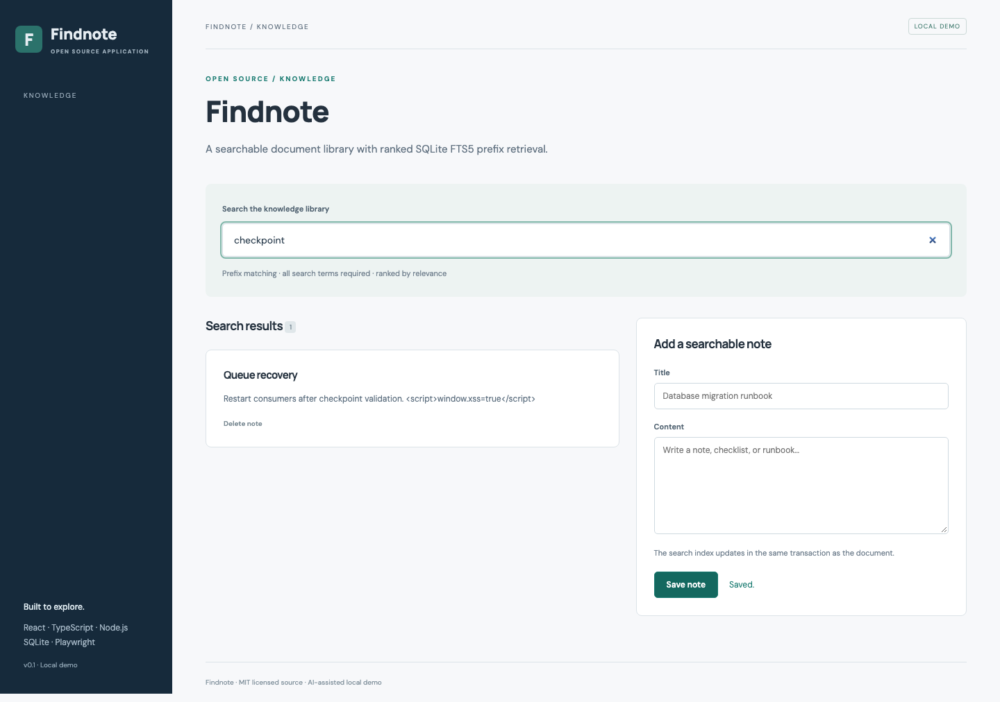

# Findnote

Full-text document search. An independently runnable open source application.

## Run and demonstrate

From this repository, run `npm ci` and `npm run dev`. Open http://127.0.0.1:5173/#search.

Create a note about database checkpoint recovery. Search for checkpoint or a prefix such as check. Add another search term to narrow the results, and delete the note to verify the index updates.

## Implementation and decisions

SQLite FTS5 ranks documents with BM25. Search terms are quoted after tokenization and joined with AND. Insert/delete triggers keep the content and index synchronized. This is lexical search; no semantic model or vector database is used.

API implementation: [`server/projects/search.ts`](server/projects/search.ts). The React workflow is in [`src/main.tsx`](src/main.tsx); storage initialization and shared middleware are in [`server/app.ts`](server/app.ts).

## API

- `GET /api/documents?q=QUERY` — list all documents or retrieve ranked prefix matches.
- `POST /api/documents` — index `{title, body}`.
- `DELETE /api/documents/:id` — remove the record and its search-index entry.

## Verification

Run `npm test` for domain/API checks. Run `npm run build`, then `npm run test:e2e` for browser flows, including **Findnote indexes a new note and renders HTML as literal text**.

## Application description

> Findnote: a searchable knowledge library using SQLite FTS5, BM25 ranking, tokenized prefix queries, and transactional index maintenance, with React rendering and tests for index updates and unsafe-looking text.

Use this as a description of the current project. Add your own reviewed contribution and disclose AI assistance when discussing development. Do not attach invented employment dates, client claims, production usage, or years of experience.

## Next contribution

Add document editing with corresponding FTS update triggers and a stale-index regression test.

MIT licensed. Initial implementation created with AI assistance in October 2026; see [CONTRIBUTIONS.md](CONTRIBUTIONS.md).

## Scope

This is a single-user local demonstration with fictional data. It has no account authentication or multi-tenant authorization. Keep it bound to loopback. Initial code was developed with AI assistance in October 2026 and extracted from Portfolio Workbench.
